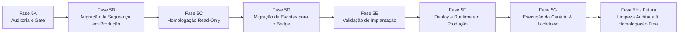

# Checkpoint de Contexto Completo — Iris Horizon CRM Multi-tenant

> **Data do Checkpoint:** 12 de Outubro de 2026 (19:10 UTC-3)  
> **Fase Atual:** **Fase 5H.2 — Implantação do Write Policy Engine em Modo Deny-All**  
> **Status da Aplicação:** Estável, compilando com 0 erros (`npm run build` validado)  
> **Repositório Oficial:** [https://github.com/Lucasnlucca/CRMiris.git](https://github.com/Lucasnlucca/CRMiris.git) (Branch: `main`)  
> **Último Commit:** [`7fca02b`](https://github.com/Lucasnlucca/CRMiris/commit/7fca02b) (`feat(security): integrate write policy engine in deny-all mode for production`)  
> **Produção Oficial (Easypanel):** [https://sites-lvplataform.grtbdz.easypanel.host/](https://sites-lvplataform.grtbdz.easypanel.host/)  
> **BaaS / Appwrite Oficial:** [https://bancosupa-appwrite.grtbdz.easypanel.host/v1](https://bancosupa-appwrite.grtbdz.easypanel.host/v1) (`PROJECT_ID: 6a6cac620021f4c64b3f`)  
> **Bancos de Dados:**
> - `crm_db`: Banco de Produção Oficial (858 documentos: 856 de negócio preservados intactos + 2 registros sintéticos canário em `notifications`)
> - `crm_isolated_test`: Sandbox de Homologação e Testes E2E Isolados

---

## 1. Linha do Tempo e Evolução das Fases



### Fases 1 a 4 (Fundação Multi-tenant e Homologação Isolada)
- Modelagem de isolamento multi-tenant (`tenant_id` autoritativo por registro).
- Resolução dos conflitos visuais e autenticação por sessão e JWT.
- Homologação de isolamento e rehearsal na base sandbox `crm_isolated_test`.

### Fase 5A (Pré-Voo de Produção, Snapshots e Fechamento de Escritas)
- **Fase 5A.1:** Reconciliação dos 3 usuários legítimos (`lucas`, `Danilo`, `teste`) e validação da contagem de documentos.
- **Fase 5A.2:** Auditoria profunda de grants e bloqueio de criação direta em collections.
- **Fase 5A.3:** Bloqueio global de escrita e geração do snapshot T-0 imutável (`snapshot_t0_summary.json`, 27 collections, 856 documentos, SHA-256 verificado).
- **Fase 5A.4:** Bloqueio do backend e auditoria de tráfego.
- **Fase 5A.5:** Adoção final da **Diretriz A** como arquitetura mandatória de segurança: remoção completa de permissões de escrita direta a clientes em nível de collection (`permissions: []`) e ativação de `documentSecurity: true`.

### Fase 5B (Migração de Segurança em Produção)
- Executada com autorização humana em `crm_db`.
- Todas as 27 collections receberam `permissions: []` e `documentSecurity: true`.
- Zero documentos criados, alterados ou perdidos (contagem estrita mantida em exatamente 856 documentos).
- Relatório: `fase5b_relatorio_pos_migracao.md`.

### Fase 5C (Homologação Pós-Migração)
- Auditoria somente leitura de produção: provou que clientes comuns não conseguem executar `createDocument`, `updateDocument` ou `deleteDocument` diretamente via Client SDK.
- Relatório: `fase5c_homologacao_pos_migracao.md`.

### Fase 5D (Integração Frontend -> Backend API Bridge)
- Criação do cliente autoritativo [`src/lib/backendApiBridge.ts`](file:///c:/Users/Usuario/Documents/projetos/ProjetoCRMMultitenet/src/lib/backendApiBridge.ts) e adaptação das operações de escrita do CRM para roteamento via backend autorizado (`/api/crm/write`).
- Relatório: `fase5d_integracao_backend_frontend.md`.

### Fase 5E (Validação da Implantação do Servidor Standalone)
- Implementação de `server/server.cjs` com rate limiting em memória, limite de payload (5MB), validação de JWT via Appwrite Account API e travas fail-closed contra produção.
- Relatório: `fase5e_validacao_implantacao_backend.md`.

### Fase 5F (Deploy Controlado e Validação de Runtime em Produção)
- **Commits Implantados:**
  - `3fbbed2`: Runner dual-process Node.js + Nginx Alpine via `server/entrypoint.sh`.
  - `5f9e8ac`: Resolução de colisão de portas (Node roda internamente em `127.0.0.1:3001` via `BRIDGE_PORT=3001`, Nginx escuta em `80`, `3000`, `4173` e proxy reverso para `/api/`).
  - `af1c313`: Ordem de avaliação de autenticação: JWT verificado antes do guard para retornar HTTP 401 em requisições anônimas e HTTP 403 com guard ativo.
- **Validação Live em Produção (`https://sites-lvplataform.grtbdz.easypanel.host`):**
  - `GET /healthz` -> HTTP 200 OK (Nginx).
  - `GET /api/healthz` -> HTTP 200 OK (Backend bridge JSON: `{"status":"UP","service":"crm-backend-api-bridge",...}`).
  - `POST /api/crm/write` sem auth -> HTTP 401 Unauthorized.
  - `POST /api/crm/write` autenticado para `crm_db` com canário desativado -> HTTP 403 Forbidden (`[FAIL-CLOSED GUARD]`).
  - Imutabilidade comprovada: exatos 856 documentos preservados em `crm_db` (0 divergências).
- Relatórios: `deploy_backend_bridge_runtime.md` e `pos_deploy_runtime_results.md`.

### Fase 5G (Preparação do Teste Canário em Produção — ATUAL)
- **Objetivo:** Preparar uma única operação canário de escrita em `crm_db`, **SEM EXECUTAR** nesta etapa.
- **Auditoria das Sete Barreiras de `validateProductionCanaryGuard`:**
  1. Chave de ativação: `CANARY_PROD_WRITE_ENABLED === 'true'`.
  2. Janela temporal: `CANARY_WINDOW_EXPIRES_AT` com timestamp ISO e expiração automática em 15 min.
  3. Ação: `action === 'create'`.
  4. Coleção: `collectionId === 'notifications'`.
  5. Tenant: `tenantId === 'tenant_default'`.
  6. Usuário: `userId === 'user_super_test'`.
  7. Marcador e prefixo: `data._is_canary_test === true` e `documentId.startsWith('canary_')`.
- **Coleção Escolhida:** `notifications` (0 documentos no baseline T-0, isolada de faturamento, vendas, Kanban, propostas e automações; no frontend o sino filtra estritamente por `Query.equal('user_id', user.id)`).
- **Compatibilidade de Schema e Commit `919b0f4`:**
  - Como o Appwrite Databases valida estritamente todos os campos recebidos em `createDocument`, e nenhum schema de `crm_db` possui o atributo `_is_canary_test` (e alterações de schema estão proibidas):
  - O bridge valida o token `_is_canary_test: true` no guard e em seguida executa `delete docData._is_canary_test;` antes de chamar `adminDb.createDocument`.
  - Fix commitado e publicado na branch `main`: [`919b0f4`](https://github.com/Lucasnlucca/CRMiris/commit/919b0f4).
- **Dry-run Validado:** Script [`scripts/test-phase5g-canary-dry-run.cjs`](file:///c:/Users/Usuario/Documents/projetos/ProjetoCRMMultitenet/scripts/test-phase5g-canary-dry-run.cjs) aprovado com **10/10 PASS**.
- **Entrega Formal:** Artefato [`fase5g_plano_teste_canario.md`](file:///c:/Users/Usuario/Documents/projetos/ProjetoCRMMultitenet/fase5g_plano_teste_canario.md).
- **Estado de Produção:** `CANARY_PROD_WRITE_ENABLED=false` e `ALLOW_PROD_BUSINESS_WRITES=false`. Nenhuma gravação efetuada.

---

## 2. Arquitetura de Runtime Implantada

```
Internet / Usuário
        │
        ▼ (Portas 80, 3000, 4173)
┌────────────────────────────────────────────────────────┐
│                   Contêiner EasyPanel                  │
│                                                        │
│  ┌──────────────────────────────────────────────────┐  │
│  │                    Nginx                         │  │
│  │  - /healthz           -> 200 OK                  │  │
│  │  - /                  -> SPA estática (dist/)    │  │
│  │  - /v1/*              -> Proxy Appwrite BaaS     │  │
│  │  - /api/*             -> Proxy para 127.0.0.1:3001│ │
│  └──────────────────────┬───────────────────────────┘  │
│                         │                              │
│                         ▼                              │
│  ┌──────────────────────────────────────────────────┐  │
│  │             Node.js Backend Bridge               │  │
│  │             (server.cjs - Porta 3001)            │  │
│  │                                                  │  │
│  │  - /api/healthz       -> JSON 200 OK             │  │
│  │  - /api/crm/write     -> Escrita Autoritativa    │  │
│  │    * Rate Limit (120 req/min)                    │  │
│  │    * Auth JWT Obrigatória (HTTP 401)             │  │
│  │    * Fail-Closed Guard (HTTP 403 para crm_db)    │  │
│  │    * validateProductionCanaryGuard (7 barreiras) │  │
│  │    * Sanitização e Gravação via Server API Key   │  │
│  └──────────────────────────────────────────────────┘  │
└────────────────────────────────────────────────────────┘
```

---

## 3. Estado Atual das Variáveis de Ambiente e Configuração

### Variáveis no EasyPanel (Produção):
```env
VITE_APPWRITE_URL=https://bancosupa-appwrite.grtbdz.easypanel.host/v1
VITE_APPWRITE_PROJECT_ID=6a6cac620021f4c64b3f
VITE_APPWRITE_DATABASE_ID=crm_db
BRIDGE_PORT=3001
CANARY_PROD_WRITE_ENABLED=false
ALLOW_PROD_BUSINESS_WRITES=false
```

### Configuração para Ativação Canário Futura (Apenas se/quando expressamente autorizada):
```env
CANARY_PROD_WRITE_ENABLED=true
CANARY_WINDOW_EXPIRES_AT=2026-10-12T03:00:00.000Z   # Janela curta de 15 min
CANARY_ALLOWED_ACTION=create
CANARY_ALLOWED_COLLECTION=notifications
CANARY_ALLOWED_TENANT=tenant_default
CANARY_ALLOWED_USER=user_super_test
```

---

## 4. Arquivos Críticos do Projeto

| Arquivo | Descrição |
| :--- | :--- |
| [`server/server.cjs`](file:///c:/Users/Usuario/Documents/projetos/ProjetoCRMMultitenet/server/server.cjs) | Servidor HTTP Node.js autônomo, rate limit, guard canário e escrita autoritativa |
| [`server/backendApiBridge.ts`](file:///c:/Users/Usuario/Documents/projetos/ProjetoCRMMultitenet/server/backendApiBridge.ts) | Implementação TypeScript do bridge de escritas e validações de tenant |
| [`server/entrypoint.sh`](file:///c:/Users/Usuario/Documents/projetos/ProjetoCRMMultitenet/server/entrypoint.sh) | Script que inicializa Node (`BRIDGE_PORT=3001`) e Nginx em paralelo |
| [`nginx.conf`](file:///c:/Users/Usuario/Documents/projetos/ProjetoCRMMultitenet/nginx.conf) | Roteamento do Nginx: SPA, `/healthz`, `/v1/` e proxy reverso `/api/` |
| [`scripts/test-phase5g-canary-dry-run.cjs`](file:///c:/Users/Usuario/Documents/projetos/ProjetoCRMMultitenet/scripts/test-phase5g-canary-dry-run.cjs) | Script que valida em dry-run as 7 barreiras e a conformidade de schema de `notifications` |
| [`scripts/test-deploy-runtime-verification.cjs`](file:///c:/Users/Usuario/Documents/projetos/ProjetoCRMMultitenet/scripts/test-deploy-runtime-verification.cjs) | Validador de runtime remoto contra `https://sites-lvplataform.grtbdz.easypanel.host` |
| [`fase5g_plano_teste_canario.md`](file:///c:/Users/Usuario/Documents/projetos/ProjetoCRMMultitenet/fase5g_plano_teste_canario.md) | Documento formal da Fase 5G com o plano detalhado de teste canário |
| [`fase5g_resultado_canario_producao.md`](file:///c:/Users/Usuario/Documents/projetos/ProjetoCRMMultitenet/fase5g_resultado_canario_producao.md) | Relatório executivo do resultado da validação e execução canário em produção |
| [`pos_deploy_runtime_results.md`](file:///c:/Users/Usuario/Documents/projetos/ProjetoCRMMultitenet/pos_deploy_runtime_results.md) | Relatório de validação de runtime pós-deploy da Fase 5F |

---

## 5. Estado do Ambiente e Próximos Passos

1. **Gravação Canário Concluída com Sucesso:**
   - O documento canário `canary_prod_test_20261012_001` foi criado com sucesso em `crm_db.notifications`.
   - Permissões estritas aplicadas: `read("team:tenant_default")` e `read("team:superadmins")`.
   - Sanitização de schema confirmada (`_is_canary_test` não persistido).
2. **Lockdown Fail-Closed Re-engajado em Produção:**
   - `CANARY_PROD_WRITE_ENABLED=false` ativo no EasyPanel.
   - Sondas de escrita bloqueadas estritamente com `HTTP 403 [FAIL-CLOSED GUARD]`.
3. **Imutabilidade Preservada em crm_db:**
   - Todas as 27 coleções permanecem com os 858 registros verificados. Zero mutações adicionais em produção.
4. **Fase 5H.1 Concluída e Homologada em Sandbox:**
   - Write Policy Engine e Circuit Breakers implementados em `server/writePolicyEngine.cjs` e `server/writePolicyEngine.ts`.
   - Menor privilégio determinístico (tuplas sem produto cartesiano, sem curingas, deny-by-default).
   - Auditoria segura com mascaramento de PII e IP implementada.
   - 21/21 testes automatizados aprovados no sandbox (`crm_isolated_test`).
   - Documento gerado: `fase5h1_policy_engine_sandbox.md`.
5. **Próxima Etapa (Fase 5H.2 / Piloto Expandido):**
   - Revisão humana do Write Policy Engine.
   - Conexão dos formulários do frontend via Backend API Bridge no sandbox antes de qualquer ativação em produção.

