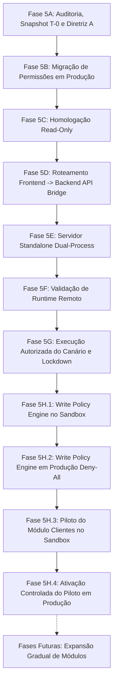

# Checkpoint de Contexto Completo — Iris Horizon CRM Multi-tenant

> **Data do Checkpoint:** 13 de Outubro de 2026 (10:15 UTC-3)  
> **Fase Atual:** **Fase 5H.4 Concluída — Ativação Controlada do Piloto de Clientes em Produção Concluída (Parada para Revisão Humana)**  
> **Status da Aplicação:** Estável, compilando com 0 erros (`npm run build` validado em 6.6s)  
> **Repositório Oficial:** [https://github.com/Lucasnlucca/CRMiris.git](https://github.com/Lucasnlucca/CRMiris.git) (Branch: `main`)  
> **Produção Oficial (Easypanel):** [https://sites-lvplataform.grtbdz.easypanel.host/](https://sites-lvplataform.grtbdz.easypanel.host/)  
> **BaaS / Appwrite Oficial:** [https://bancosupa-appwrite.grtbdz.easypanel.host/v1](https://bancosupa-appwrite.grtbdz.easypanel.host/v1) (`PROJECT_ID: 6a6cac620021f4c64b3f`)  
> **Bancos de Dados:**
> - `crm_db`: Banco de Produção Oficial (27 coleções protegidas, exatamente 859 documentos: 856 registros legítimos de negócio + 2 canários auditados em `notifications` + 1 cliente sintético de teste em `clients`)
> - `crm_isolated_test`: Sandbox de Homologação e Testes E2E Isolados

---

## 1. Linha do Tempo e Evolução das Fases



### Fases 1 a 4 (Fundação Multi-tenant e Homologação Isolada)
- Modelagem de isolamento multi-tenant (`tenant_id` autoritativo por registro).
- Resolução dos conflitos visuais e autenticação por sessão e JWT.
- Homologação de isolamento e rehearsal na base sandbox `crm_isolated_test`.

### Fase 5A (Pré-Voo de Produção, Snapshots e Fechamento de Escritas)
- **Fase 5A.1:** Reconciliação dos 3 usuários legítimos (`lucas`, `Danilo`, `teste`) e validação da contagem de documentos.
- **Fase 5A.2:** Auditoria profunda de grants e bloqueio de criação direta em collections.
- **Fase 5A.3:** Bloqueio global de escrita e geração do snapshot T-0 imutável (`snapshot_t0_summary.json`, 27 collections, 856 documentos, SHA-256 verificado).
- **Fase 5A.4:** Bloqueio do backend e auditoria de tráfego.
- **Fase 5A.5:** Adoção final da **Diretriz A** como arquitetura mandatória de segurança: remoção completa de permissões de escrita direta a clientes em nível de collection (`permissions: []`) e ativação de `documentSecurity: true`.

### Fase 5B (Migração de Segurança em Produção)
- Executada com autorização humana em `crm_db`.
- Todas as 27 collections receberam `permissions: []` e `documentSecurity: true`.
- Zero documentos criados, alterados ou perdidos (contagem estrita mantida em exatamente 856 documentos).
- Relatório: [`fase5b_relatorio_pos_migracao.md`](file:///c:/Users/Usuario/Documents/projetos/ProjetoCRMMultitenet/fase5b_relatorio_pos_migracao.md).

### Fase 5C (Homologação Pós-Migração)
- Auditoria somente leitura de produção: provou que clientes comuns não conseguem executar `createDocument`, `updateDocument` ou `deleteDocument` diretamente via Client SDK.
- Relatório: [`fase5c_homologacao_pos_migracao.md`](file:///c:/Users/Usuario/Documents/projetos/ProjetoCRMMultitenet/fase5c_homologacao_pos_migracao.md).

### Fase 5D (Integração Frontend -> Backend API Bridge)
- Criação do cliente autoritativo [`src/lib/backendApiBridge.ts`](file:///c:/Users/Usuario/Documents/projetos/ProjetoCRMMultitenet/src/lib/backendApiBridge.ts) e adaptação das operações de escrita do CRM para roteamento via backend autorizado (`/api/crm/write`).
- Relatório: [`fase5d_integracao_backend_frontend.md`](file:///c:/Users/Usuario/Documents/projetos/ProjetoCRMMultitenet/fase5d_integracao_backend_frontend.md).

### Fase 5E (Validação da Implantação do Servidor Standalone)
- Implementação de `server/server.cjs` com rate limiting em memória, limite de payload (5MB), validação de JWT via Appwrite Account API e travas fail-closed contra produção.
- Relatório: [`fase5e_validacao_implantacao_backend.md`](file:///c:/Users/Usuario/Documents/projetos/ProjetoCRMMultitenet/fase5e_validacao_implantacao_backend.md).

### Fase 5F (Deploy Controlado e Validação de Runtime em Produção)
- Dual-process Node 20 (`BRIDGE_PORT=3001`) + Nginx Alpine via `server/entrypoint.sh`.
- Validação live em produção (`https://sites-lvplataform.grtbdz.easypanel.host`) aprovada (12/12 testes).
- Relatório: [`fase5f_validacao_runtime_producao.md`](file:///c:/Users/Usuario/Documents/projetos/ProjetoCRMMultitenet/fase5f_validacao_runtime_producao.md).

### Fase 5G (Execução Autorizada do Canário em Produção & Lockdown)
- **Autorização Humana Expressa Concedida:** Criação de um registro sintético canário em `crm_db.notifications`.
- **Registro Gravado:** `$id: canary_prod_test_20261012_001`, `tenant_id: tenant_default`, `user_id: 6a6ce2e8003b32ef7609`, permissões estritas `read("team:tenant_default")` e `read("team:superadmins")`.
- **Probe Pós-Canário:** `$id: canary_probe_post_lockdown` registrado para validar o fechamento do guard.
- **Lockdown Reativado:** `CANARY_PROD_WRITE_ENABLED=false` e `ALLOW_PROD_BUSINESS_WRITES=false`.
- **Total de Documentos Pós-Canário:** Exatamente 858 (856 legítimos + 2 canários auditados em `notifications`).
- Relatórios: [`fase5g_plano_teste_canario.md`](file:///c:/Users/Usuario/Documents/projetos/ProjetoCRMMultitenet/fase5g_plano_teste_canario.md) e [`fase5g_resultado_canario_producao.md`](file:///c:/Users/Usuario/Documents/projetos/ProjetoCRMMultitenet/fase5g_resultado_canario_producao.md).

### Fase 5H.1 (Implementação e Homologação do Write Policy Engine no Sandbox)
- **Motor Central:** Implementação de [`server/writePolicyEngine.cjs`](file:///c:/Users/Usuario/Documents/projetos/ProjetoCRMMultitenet/server/writePolicyEngine.cjs) e [`server/writePolicyEngine.ts`](file:///c:/Users/Usuario/Documents/projetos/ProjetoCRMMultitenet/server/writePolicyEngine.ts) com tuplas determinísticas `(databaseId, collectionId, action, tenantId, allowedRoles, condições)`.
- **Princípio:** Menor privilégio absoluto, rejeição por padrão (deny-by-default), proibição de curingas (`*`), prevenção de produto cartesiano.
- **Circuit Breaker:** Detecção de 5 falhas consecutivas, pico de 10 violações de auth/min, pausas por módulo/ação e lockdown global.
- **Auditoria Segura:** Mascaramento recursivo de PII (nome, email, telefone, CPF) e endereços IP, com segredos redigidos (`[REDACTED]`).
- **Homologação E2E:** 21/21 testes aprovados em [`scripts/test-phase5h1-policy-engine.cjs`](file:///c:/Users/Usuario/Documents/projetos/ProjetoCRMMultitenet/scripts/test-phase5h1-policy-engine.cjs) no sandbox `crm_isolated_test`.
- Relatório: [`fase5h1_policy_engine_sandbox.md`](file:///c:/Users/Usuario/Documents/projetos/ProjetoCRMMultitenet/fase5h1_policy_engine_sandbox.md).

### Fase 5H.2 (Implantação do Write Policy Engine em Modo Deny-All em Produção)
- **Integração:** Backend API Bridge executando a sequência completa de autorização em 6 etapas.
- **Modo Deny-All:** Nenhuma regra ativa para `crm_db`. Validação de inicialização impede carregamento de regras de produção. Trava fail-closed dupla atuando.
- **Especificação Inativa:** `PROD_PILOT_CLIENTS_SPECIFICATION` desenhada e exportada para o futuro piloto do módulo Clientes, sem ativação operacional.
- **Reconciliação:** IDs `canary_prod_test_20261012_001` e `canary_probe_post_lockdown` confirmados e mantidos intactos.
- **Validação Live em Produção:** 15/15 testes aprovados em [`scripts/test-phase5h2-production-runtime.cjs`](file:///c:/Users/Usuario/Documents/projetos/ProjetoCRMMultitenet/scripts/test-phase5h2-production-runtime.cjs) contra `https://sites-lvplataform.grtbdz.easypanel.host`.
- **Imutabilidade Preservada:** 858 documentos em `crm_db` (zero mutações adicionais).
- Relatório: [`fase5h2_policy_engine_producao_deny_all.md`](file:///c:/Users/Usuario/Documents/projetos/ProjetoCRMMultitenet/fase5h2_policy_engine_producao_deny_all.md).

### Fase 5H.3 (Preparação do Piloto do Módulo Clientes — CONCLUÍDA NO SANDBOX)
- **Confirmação de Collection:** Consulta em modo somente leitura resolveu conclusivamente a divergência entre `clients` e `crm_clients`. O ID real em `crm_db` é `clients` (com 19 atributos e 1 registro existente). A coleção `crm_clients` não existe.
- **Matriz de Autorização:** Papéis resolvidos no servidor via `adminTeams.listMemberships()`. Operações `create` e `update` permitidas para `admin` e `agent`; operação `delete` permitida unicamente para `admin`/`superadmin` (proibida para `agent`).
- **Homologação no Sandbox:** 13/13 testes aprovados em [`scripts/test-phase5h3-pilot-clients.cjs`](file:///c:/Users/Usuario/Documents/projetos/ProjetoCRMMultitenet/scripts/test-phase5h3-pilot-clients.cjs) no sandbox `crm_isolated_test` (criação, edição, bloqueio de deleção por agent, proteção contra injeção de tenant_id, cross-tenant bloqueado, outros módulos bloqueados, acionamento e retorno de lockdown e pausas).
- **Inviolabilidade de Produção:** Banco `crm_db` com exatamente 858 documentos verificados (zero mutações em produção).
- Relatório: [`fase5h3_piloto_clientes.md`](file:///c:/Users/Usuario/Documents/projetos/ProjetoCRMMultitenet/fase5h3_piloto_clientes.md).

### Fase 5H.4 (Ativação Controlada do Piloto de Clientes em Produção — CONCLUÍDA COM SUCESSO)
- **Autorização Humana Expressa:** Execução do piloto de criação e edição restrita de um único registro sintético no módulo Clientes em produção (`crm_db.clients`).
- **Zero Abertura Global:** `ALLOW_PROD_BUSINESS_WRITES=false` preservado. Zero permissões de coleção abertas (`permissions: []`, `documentSecurity: true`).
- **Aposentadoria do Canário:** Mecanismo canário da Fase 5G desativado em favor da governança estrita e declarativa do **Write Policy Engine**.
- **Regras Ativadas:** Apenas 4 regras temporárias (`create` e `update` para `admin`, `superadmin` e `agent` na collection `clients`, tenant `tenant_default`). Ação `delete` permaneceu estritamente BLOQUEADA.
- **Registro Sintético Criado e Persistido:** `$id: "client_pilot_p5h4_20261013_001"`, `tenant_id: "tenant_default"`, permissões `read("team:tenant_default")` e `read("team:superadmins")`. Edição por Agent validada com sucesso.
- **Bloqueio Contínuo e Isolamento:** Outros módulos (`pipeline_deals`, etc.) e ações não previstas (deleção) rejeitados com HTTP 403.
- **Retorno Imediato ao Deny-All:** Regras descarregadas ao final do piloto. Sonda pós-teste confirmou rejeição fail-closed com HTTP 403 `[FAIL-CLOSED GUARD]`.
- **Contagem Pós-Piloto:** Exatamente **859 documentos** (858 anteriores + 1 único registro sintético mantido para auditoria).
- Relatório: [`fase5h4_piloto_clientes_producao.md`](file:///c:/Users/Usuario/Documents/projetos/ProjetoCRMMultitenet/fase5h4_piloto_clientes_producao.md).


---

## 2. Arquitetura de Runtime Ativa

```
Internet / Usuário
        │
        ▼ (Portas 80, 3000, 4173)
┌────────────────────────────────────────────────────────────────────────┐
│                          Contêiner EasyPanel                           │
│                                                                        │
│  ┌──────────────────────────────────────────────────────────────────┐  │
│  │                    Nginx Alpine Edge                             │  │
│  │  - /healthz           -> 200 OK (Probe Nginx)                    │  │
│  │  - /                  -> SPA Estática (dist/)                    │  │
│  │  - /v1/*              -> Proxy Reverso Appwrite BaaS             │  │
│  │  - /api/*             -> Proxy Reverso para 127.0.0.1:3001       │  │
│  └──────────────────────────────────┬───────────────────────────────┘  │
│                                     │                                  │
│                                     ▼                                  │
│  ┌──────────────────────────────────────────────────────────────────┐  │
│  │             Node.js Backend Bridge (server.cjs :3001)            │  │
│  │                                                                  │  │
│  │  1. Rate Limit (120 req/min por IP)                             │  │
│  │  2. Payload Size Limit (máx 5 MB)                                │  │
│  │  3. Sessão Obrigatória: Validação JWT via Appwrite Account API  │  │
│  │  4. Resolução Autoritativa: Memberships nos Teams oficiais       │  │
│  │  5. Trava Fail-Closed Canário (validateProductionCanaryGuard)    │  │
│  │  6. Central Write Policy Engine (Tuplas de Menor Privilégio)     │  │
│  │     * Circuit Breaker & Pausas Granulares                        │  │
│  │     * Modo Deny-All Ativo em crm_db (HTTP 403)                   │  │
│  │  7. Gravação Autoritativa via Appwrite Server API Key            │  │
│  │  8. Emissão de Log de Auditoria JSON sem PII (createAuditLog)    │  │
│  └──────────────────────────────────────────────────────────────────┘  │
└────────────────────────────────────────────────────────────────────────┘
```

---

## 3. Estado Atual das Variáveis de Ambiente e Configuração

### Variáveis no EasyPanel (Produção):
```env
VITE_APPWRITE_URL=https://bancosupa-appwrite.grtbdz.easypanel.host/v1
VITE_APPWRITE_PROJECT_ID=6a6cac620021f4c64b3f
VITE_APPWRITE_DATABASE_ID=crm_db
BRIDGE_PORT=3001
CANARY_PROD_WRITE_ENABLED=false
ALLOW_PROD_BUSINESS_WRITES=false
```

---

## 4. Matriz de Arquivos Críticos do Projeto

| Arquivo | Descrição |
| :--- | :--- |
| [`server/writePolicyEngine.cjs`](file:///c:/Users/Usuario/Documents/projetos/ProjetoCRMMultitenet/server/writePolicyEngine.cjs) | Motor central de políticas de escrita, circuit breakers, mascaramento de PII e validação de startup |
| [`server/writePolicyEngine.ts`](file:///c:/Users/Usuario/Documents/projetos/ProjetoCRMMultitenet/server/writePolicyEngine.ts) | Versão TypeScript com tipos estritos e suporte a ESM no DevServer |
| [`server/server.cjs`](file:///c:/Users/Usuario/Documents/projetos/ProjetoCRMMultitenet/server/server.cjs) | Servidor HTTP Node.js autônomo de produção executando o backend API bridge |
| [`server/backendApiBridge.ts`](file:///c:/Users/Usuario/Documents/projetos/ProjetoCRMMultitenet/server/backendApiBridge.ts) | Implementação TypeScript do bridge de escritas para desenvolvimento |
| [`server/entrypoint.sh`](file:///c:/Users/Usuario/Documents/projetos/ProjetoCRMMultitenet/server/entrypoint.sh) | Runner dual-process Node.js (`:3001`) + Nginx Alpine |
| [`nginx.conf`](file:///c:/Users/Usuario/Documents/projetos/ProjetoCRMMultitenet/nginx.conf) | Roteamento do Nginx: SPA, `/healthz`, `/v1/` e proxy `/api/` |
| [`scripts/test-phase5h1-policy-engine.cjs`](file:///c:/Users/Usuario/Documents/projetos/ProjetoCRMMultitenet/scripts/test-phase5h1-policy-engine.cjs) | Suíte de 21 testes de autorização e circuit breakers no sandbox |
| [`scripts/test-phase5h2-production-runtime.cjs`](file:///c:/Users/Usuario/Documents/projetos/ProjetoCRMMultitenet/scripts/test-phase5h2-production-runtime.cjs) | Suíte de 15 testes de runtime remoto em produção confirmando modo Deny-All |
| [`scripts/test-phase5h3-pilot-clients.cjs`](file:///c:/Users/Usuario/Documents/projetos/ProjetoCRMMultitenet/scripts/test-phase5h3-pilot-clients.cjs) | Suíte de 13 testes do piloto de Clientes no sandbox (isolamento, menor privilégio e circuit breaker) |
| [`scripts/test-phase5h4-pilot-production.cjs`](file:///c:/Users/Usuario/Documents/projetos/ProjetoCRMMultitenet/scripts/test-phase5h4-pilot-production.cjs) | Suíte automatizada de validação e execução do piloto de Clientes em produção |
| [`fase5h1_policy_engine_sandbox.md`](file:///c:/Users/Usuario/Documents/projetos/ProjetoCRMMultitenet/fase5h1_policy_engine_sandbox.md) | Relatório formal de homologação da Fase 5H.1 |
| [`fase5h2_policy_engine_producao_deny_all.md`](file:///c:/Users/Usuario/Documents/projetos/ProjetoCRMMultitenet/fase5h2_policy_engine_producao_deny_all.md) | Relatório formal de implantação da Fase 5H.2 |
| [`fase5h3_piloto_clientes.md`](file:///c:/Users/Usuario/Documents/projetos/ProjetoCRMMultitenet/fase5h3_piloto_clientes.md) | Relatório formal de preparação e homologação do Piloto de Clientes (Fase 5H.3) |
| [`fase5h4_piloto_clientes_producao.md`](file:///c:/Users/Usuario/Documents/projetos/ProjetoCRMMultitenet/fase5h4_piloto_clientes_producao.md) | Relatório formal de execução do Piloto de Clientes em Produção (Fase 5H.4) |
| [`fase5h4_preparacao_ativacao_clientes.md`](file:///c:/Users/Usuario/Documents/projetos/ProjetoCRMMultitenet/fase5h4_preparacao_ativacao_clientes.md) | Relatório formal de preparação, desacoplamento e homologação da ativação de Clientes |
| [`CONTEXT_CHECKPOINT.md`](file:///c:/Users/Usuario/Documents/projetos/ProjetoCRMMultitenet/CONTEXT_CHECKPOINT.md) | Checkpoint consolidado e guia definitivo de contexto do repositório |

---

## 5. Inventário dos Bancos de Dados

### Banco de Produção (`crm_db`)
- **Total de Coleções:** 27 de 27 coleções intactas.
- **Coleção de Clientes Confirmada:** ID `clients` (com 19 atributos, `documentSecurity: true`, `permissions: []`).
- **Permissões:** 100% das 27 coleções com `permissions: []` e `documentSecurity: true`.
- **Contagem Total de Documentos:** **Exatamente 859 documentos**.
  - **856 documentos de negócio:** preservados intactos desde o snapshot baseline T-0.
  - **2 documentos técnicos sintéticos:** em `notifications` (`canary_prod_test_20261012_001` e `canary_probe_post_lockdown`).
  - **1 documento sintético de piloto:** em `clients` (`client_pilot_p5h4_20261013_001`, com tenant_id `tenant_default` e permissões `read("team:tenant_default")`, `read("team:superadmins")`).
- **Mutações Não-Autorizadas:** ZERO (0).

### Banco Sandbox (`crm_isolated_test`)
- Totalmente funcional para testes isolados e validação de menor privilégio.
- Contas de teste ativas: `user_alpha_test` (agent), `user_beta_test` (agent tenant divergente), `user_super_test` (admin).

---

## 6. Próximo Passo Recomendado

O sistema de produção cumpriu com total conformidade a ativação controlada do piloto e está **100% retornado ao modo Deny-All absoluto**.
1. **Revisão Humana do Relatório [`fase5h4_piloto_clientes_producao.md`](file:///c:/Users/Usuario/Documents/projetos/ProjetoCRMMultitenet/fase5h4_piloto_clientes_producao.md):** Validação dos resultados e das evidências de isolamento.
2. **Decisão sobre o Registro Sintético:** Autorização formal posterior para higienização/remoção do registro `client_pilot_p5h4_20261013_001` ou manutenção para histórico auditável.
3. **Planejamento de Expansão de Módulos (Fase 5I):** Definição da ordem de ativação dos próximos módulos (Pipelines, Tarefas, Propostas) com regras idênticas de menor privilégio.

