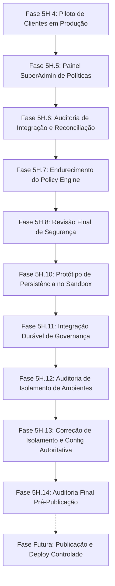

# Checkpoint de Contexto Completo — Iris Horizon CRM Multi-tenant

> **Data do Checkpoint:** 13 de Outubro de 2026 (23:45 UTC-3)  
> **Fase Atual:** **Fase 5H.14 Concluída — Revisão Humana Pré-Publicação e Auditoria Final Concluída**  
> **Veredito:** **APTO PARA PLANEJAR PUBLICAÇÃO CONTROLADA**  
> **Status da Aplicação:** Estável, compilando com 0 erros (`npm run build` validado: 1537 módulos transformados)  
> **Repositório Oficial:** [https://github.com/Lucasnlucca/CRMiris.git](https://github.com/Lucasnlucca/CRMiris.git) (Branch: `main`)  
> **Head Local:** `6758e89` (3 commits à frente de `origin/main` em `e68cf77`)  
> **Produção Oficial (Easypanel):** [https://sites-lvplataform.grtbdz.easypanel.host/](https://sites-lvplataform.grtbdz.easypanel.host/)  
> **BaaS / Appwrite Oficial:** [https://bancosupa-appwrite.grtbdz.easypanel.host/v1](https://bancosupa-appwrite.grtbdz.easypanel.host/v1) (`PROJECT_ID: 6a6cac620021f4c64b3f`)  
> **Bancos de Dados:**
> - `crm_db`: Banco de Produção Oficial (27 coleções protegidas, exatamente 859 documentos: 856 legítimos de negócio + 2 canários auditados em `notifications` + 1 cliente sintético de teste em `clients`).
> - `crm_isolated_test`: Sandbox de Homologação e Testes E2E Isolados (inclui coleção `system_policy_governance` v54 para persistência de políticas).

---

## 1. Linha do Tempo e Evolução Recente das Fases



### Resumo das Fases 5H.5 a 5H.14

- **Fase 5H.5:** Implementação do Painel SuperAdmin de Controle Operacional de Políticas e Circuit Breakers ([src/pages/SuperAdminPolicyPanel.tsx](file:///c:/Users/Usuario/Documents/projetos/ProjetoCRMMultitenet/src/pages/SuperAdminPolicyPanel.tsx)).
- **Fases 5H.6 a 5H.8:** Auditorias de segurança, reconciliação estrita do banco de produção (27 coleções e 859 documentos confirmados), verificação de ausência de segredos em código.
- **Fase 5H.10:** Implementação e homologação isolada do protótipo de persistência durável no sandbox `crm_isolated_test` com a coleção `system_policy_governance`.
- **Fase 5H.11:** Integração do adaptador de persistência atômico com controle de concorrência otimista (OCC via `expectedVersion`) e sincronização durável no sandbox.
- **Fase 5H.12:** Auditoria de integração identificando riscos de acoplamento com referências estáticas no startup de servidores.
- **Fase 5H.13:** Correção definitiva de isolamento:
  - Eliminação de referências fixas (`syncFromDurable('crm_isolated_test')`) no startup standalone e no Vite.
  - Criação da configuração de governança autoritativa server-side ([server/governanceConfig.cjs](file:///c:/Users/Usuario/Documents/projetos/ProjetoCRMMultitenet/server/governanceConfig.cjs) e [.ts](file:///c:/Users/Usuario/Documents/projetos/ProjetoCRMMultitenet/server/governanceConfig.ts)).
  - Rejeição de seleção de banco pelo cliente via frontend com **HTTP 403 `[CLIENT_DATABASE_OVERRIDE_REJECTED]`**.
  - Padrão seguro `ENABLE_PROD_GOVERNANCE_PERSISTENCE=false`.
- **Fase 5H.14:** Auditoria pré-publicação final independente:
  - 13/13 testes aprovados na suíte de isolamento.
  - 21/21 testes aprovados na suíte de persistência.
  - 19/19 testes aprovados na suíte de segurança.
  - 0 erros no build de produção.
  - Inviolabilidade de `crm_db` confirmada (27 coleções, 859 docs).

---

## 2. Estado Atual do Repositório Git

- **Branch:** `main`
- **Commits Locais Pendentes de Push (3 commits):**
  1. `752ce13`: *feat(security): implement controlled production policy for clients module*
  2. `138d82d`: *docs: add phase 5h.4 clients activation preparation report reference*
  3. `6758e89`: *feat(security): implement SuperAdmin operational policy control panel and circuit breakers*
- **Arquivos Modificados no Working Tree (Unstaged):**
  - [server/adminPolicyHandler.cjs](file:///c:/Users/Usuario/Documents/projetos/ProjetoCRMMultitenet/server/adminPolicyHandler.cjs)
  - [server/adminPolicyHandler.ts](file:///c:/Users/Usuario/Documents/projetos/ProjetoCRMMultitenet/server/adminPolicyHandler.ts)
  - [server/server.cjs](file:///c:/Users/Usuario/Documents/projetos/ProjetoCRMMultitenet/server/server.cjs)
  - [server/vitePluginApiBridge.ts](file:///c:/Users/Usuario/Documents/projetos/ProjetoCRMMultitenet/server/vitePluginApiBridge.ts)
  - [server/writePolicyEngine.cjs](file:///c:/Users/Usuario/Documents/projetos/ProjetoCRMMultitenet/server/writePolicyEngine.cjs)
  - [server/writePolicyEngine.ts](file:///c:/Users/Usuario/Documents/ProjetoCRMMultitenet/server/writePolicyEngine.ts)
  - [src/lib/adminPolicyApi.ts](file:///c:/Users/Usuario/Documents/projetos/ProjetoCRMMultitenet/src/lib/adminPolicyApi.ts)
  - [src/pages/SuperAdminPolicyPanel.tsx](file:///c:/Users/Usuario/Documents/projetos/ProjetoCRMMultitenet/src/pages/SuperAdminPolicyPanel.tsx)
- **Arquivos Novos Untracked:**
  - `server/governanceConfig.cjs`
  - `server/governanceConfig.ts`
  - `server/governancePersistenceAdapter.ts`
  - `server/governancePersistencePrototype.cjs`
  - `reconciliacao_estado_producao_readonly.md`
  - Relatórios: `fase5h13_correcao_isolamento_ambientes.md`, `fase5h14_revisao_pre_publicacao.md`

---

## 3. Estado das Variáveis e Configuração de Governança

### Padrão Seguro de Produção:
```env
# Banco de Produção
VITE_APPWRITE_DATABASE_ID=crm_db
BRIDGE_PORT=3001

# Travas de Produção
ALLOW_PROD_BUSINESS_WRITES=false
CANARY_PROD_WRITE_ENABLED=false
ENABLE_PROD_CLIENTS_MODULE=false

# Governança Autoritativa (Server-side)
GOVERNANCE_ENVIRONMENT=production
GOVERNANCE_DATABASE_ID=crm_db
ENABLE_PROD_GOVERNANCE_PERSISTENCE=false
```

### Comportamento Assegurado:
- `DEFAULT_DATABASE_ID` **não** é assumido como banco de governança.
- Com `ENABLE_PROD_GOVERNANCE_PERSISTENCE=false`, o motor de políticas de produção opera puramente em memória (`mode: 'STATIC'`). Nenhuma tentativa de leitura ou escrita é feita na coleção de governança em `crm_db`.
- Se configurado `ENABLE_PROD_GOVERNANCE_PERSISTENCE=true` em produção sem migração de schema, o sistema entra em **Fail-Closed imediato** (`PROD_GOVERNANCE_PERSISTENCE_UNAVAILABLE`) com HTTP 503.

---

## 4. Matriz de Arquivos Críticos de Governança e Segurança

| Arquivo | Descrição |
| :--- | :--- |
| [`server/governanceConfig.cjs`](file:///c:/Users/Usuario/Documents/projetos/ProjetoCRMMultitenet/server/governanceConfig.cjs) / [`.ts`](file:///c:/Users/Usuario/Documents/projetos/ProjetoCRMMultitenet/server/governanceConfig.ts) | Resolução autoritativa de configuração, validação de ambiente e fail-closed |
| [`server/adminPolicyHandler.cjs`](file:///c:/Users/Usuario/Documents/projetos/ProjetoCRMMultitenet/server/adminPolicyHandler.cjs) / [`.ts`](file:///c:/Users/Usuario/Documents/projetos/ProjetoCRMMultitenet/server/adminPolicyHandler.ts) | Handlers das rotas `/api/admin/policy`, autorização SuperAdmin e bloqueio de override do cliente |
| [`server/writePolicyEngine.cjs`](file:///c:/Users/Usuario/Documents/projetos/ProjetoCRMMultitenet/server/writePolicyEngine.cjs) / [`.ts`](file:///c:/Users/Usuario/Documents/projetos/ProjetoCRMMultitenet/server/writePolicyEngine.ts) | Motor de menor privilégio, circuit breakers, gate de governança e mascaramento de PII |
| [`server/server.cjs`](file:///c:/Users/Usuario/Documents/projetos/ProjetoCRMMultitenet/server/server.cjs) | Servidor standalone com rate limit, JWT auth e startup seguro via `initializeGovernance` |
| [`server/vitePluginApiBridge.ts`](file:///c:/Users/Usuario/Documents/projetos/ProjetoCRMMultitenet/server/vitePluginApiBridge.ts) | Bridge de desenvolvimento com runtime Vite isolado para testes locais |
| [`server/governancePersistenceAdapter.ts`](file:///c:/Users/Usuario/Documents/projetos/ProjetoCRMMultitenet/server/governancePersistenceAdapter.ts) | Adaptador tipado para persistência durável no Appwrite |
| [`fase5h13_correcao_isolamento_ambientes.md`](file:///c:/Users/Usuario/Documents/projetos/ProjetoCRMMultitenet/fase5h13_correcao_isolamento_ambientes.md) | Relatório formal de homologação e correção de isolamento da Fase 5H.13 |
| [`fase5h14_revisao_pre_publicacao.md`](file:///c:/Users/Usuario/Documents/projetos/ProjetoCRMMultitenet/fase5h14_revisao_pre_publicacao.md) | Relatório da auditoria pré-publicação da Fase 5H.14 |

---

## 5. Próximos Passos Quando Retomar

1. **Revisão Humana:** Usuário avalia o relatório [fase5h14_revisao_pre_publicacao.md](file:///c:/Users/Usuario/Documents/projetos/ProjetoCRMMultitenet/fase5h14_revisao_pre_publicacao.md).
2. **Empacotamento / Commit Limpo:** Quando autorizado, organizar os arquivos modificados e os novos arquivos de governança em commits atômicos e descritivos.
3. **Publicação Controlada (Push):** Sincronizar os commits com `origin/main`.
4. **Deploy de Réplica Única no EasyPanel:** Implantar o contêiner mantendo `replicas: 1` e as travas de produção desabilitadas (`ALLOW_PROD_BUSINESS_WRITES=false`, `ENABLE_PROD_GOVERNANCE_PERSISTENCE=false`).
